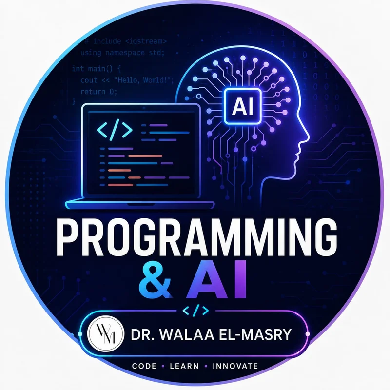

  

<h1 align="center">⚡ INTERACTIVE ACTIVITIES</h1>

  <b>PROGRAMMING & AI · YEAR 2 BACCALAUREATE</b>

  Interactive educational experiences designed to transform learning into an engaging digital journey.

  
  
  

---

## 👑 PROJECT OWNERSHIP

| Role | Name |
|---|---|
| **Project Owner** | Dr. Walaa El-Masry |
| **Developer** | [@mohamed-Mma](https://github.com/mohamed-Mma) |
| **Project** | Interactive Programming & AI Activities |
| **Target** | Year 2 Baccalaureate Students |

---

## 📌 ABOUT THE PROJECT

This project is a collection of interactive educational activities developed for the **Programming & Artificial Intelligence curriculum**.

It aims to provide students with an engaging, interactive, and practical learning experience through digital activities and educational simulations.

The project includes interactive experiences covering different topics, presented through a custom-designed web interface.

---

## 🔒 PROPRIETARY PROJECT

> **THIS PROJECT IS NOT OPEN SOURCE.**

This repository is published for demonstration, portfolio visibility, and authorized access only.

Public visibility does not mean public permission.

Viewing this repository does not grant any license or rights to reuse, reproduce, modify, redistribute, publish, or commercially exploit its contents.

### 🚫 RESTRICTED ACTIVITIES

Without prior written authorization from the rights holder, the following are prohibited to the extent permitted by applicable law:

| Activity | Authorization |
|---|:---:|
| Copying source code | ❌ Prohibited |
| Reusing UI/UX or design elements | ❌ Prohibited |
| Reproducing activities or simulations | ❌ Prohibited |
| Modifying or creating derivative works | ❌ Prohibited |
| Republishing or redistribution | ❌ Prohibited |
| Selling or commercially exploiting | ❌ Prohibited |
| Using in another course or platform | ❌ Prohibited |
| Removing copyright notices or credits | ❌ Prohibited |
| Claiming this project as your own | ❌ Prohibited |
| Using project assets outside authorized access | ❌ Prohibited |

---

## 🛡️ INTELLECTUAL PROPERTY & COPYRIGHT

All rights in the project are reserved, subject to applicable law and the rights of their respective contributors and third-party content owners.

The protected materials may include, where owned by the relevant rights holder:

- Source code and implementation.
- Website structure and layout.
- User interface and user experience designs.
- Interactive activities and educational simulations.
- Graphics, logos, images, and visual assets.
- Written content and original educational materials.
- Custom functionality and project-specific components.

No ownership rights are transferred to visitors, users, or third parties by accessing this repository.

---

## 📜 LICENSE — STRICT PROPRIETARY LICENSE

**Copyright © Dr. Walaa El-Masry. All Rights Reserved.**

This project is proprietary and is not licensed under any open-source license.

No permission is granted to any person or entity to use, copy, reproduce, modify, adapt, distribute, publish, sublicense, sell, or create derivative works from any portion of this project without prior explicit written authorization from the applicable rights holder.

### 1. No License Granted
Access to the repository does not constitute a license, assignment, transfer, or grant of intellectual property rights.

### 2. No Unauthorized Use
Any use beyond viewing the repository through authorized GitHub functionality requires separate authorization, where applicable.

### 3. No Redistribution
Redistributing, mirroring, republishing, or making copies of this project or its components is prohibited without written approval.

### 4. No Commercial Exploitation
Commercial use, monetization, resale, or incorporation into commercial products or services is prohibited without a separate written license.

### 5. No Ownership Misrepresentation
No person may falsely claim authorship, ownership, development, or original creation of materials belonging to others.

### 6. Third-Party Materials
Third-party libraries, frameworks, and materials remain subject to their respective licenses and ownership terms. This notice does not override third-party rights.

### 7. Reservation of Rights
All rights not expressly granted in writing are reserved by their respective rights holders.

### 8. Enforcement
Unauthorized uses may result in requests for removal, repository or content takedown procedures, or other remedies available under applicable law.

---

## 🔑 REQUESTING PERMISSION

Interested in using, adapting, integrating, or licensing this project?

Written authorization must be obtained before any use requiring permission.

**Developer & Permission Contact:**

### [@mohamed-Mma](https://github.com/mohamed-Mma)

Permission is valid only within the scope expressly approved in writing. Approval for one purpose does not automatically authorize any other use.

---

## 👨‍💻 DEVELOPMENT & CREDITS

| Contribution | Credits |
|---|---|
| Project Ownership | Dr. Walaa El-Masry |
| Web Development | [Mohamed Mahmoud (@mohamed-Mma)](https://github.com/mohamed-Mma) |
| Design & Implementation | Project Development Team |
| Educational Direction | Dr. Walaa El-Masry |

---

## ⚠️ COPYRIGHT NOTICE

This project is protected by applicable copyright and intellectual property laws.

**Unauthorized copying, redistribution, commercial use, or misrepresentation of ownership may violate applicable laws.**

If you wish to use any part of this project, obtain written permission before doing so.

---

  <b>© DR. WALAA EL-MASRY</b> 
  PROGRAMMING & ARTIFICIAL INTELLIGENCE  
  Developed by <a href="https://github.com/mohamed-Mma"><b>@mohamed-Mma</b></a>  
  <code>PROPRIETARY · ALL RIGHTS RESERVED · AUTHORIZATION REQUIRED</code>

